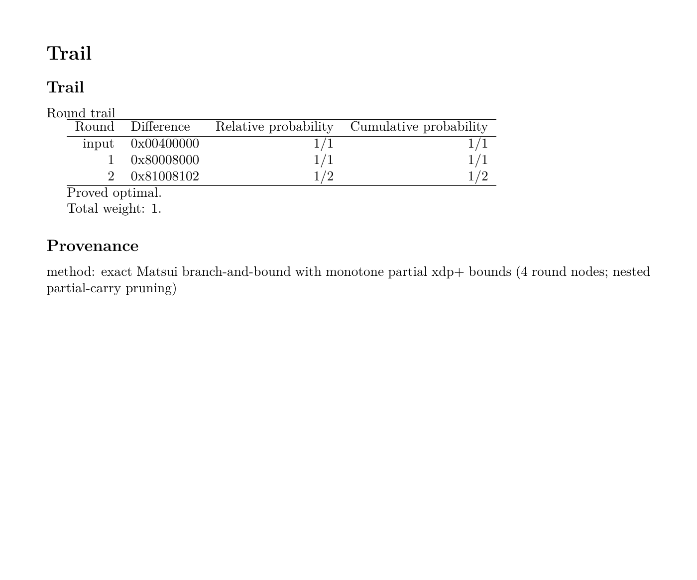

Reporting and exporting results
===============================

CLAASP presents already-produced typed results. ``present(result)`` never runs
an analysis, solver, statistical program, or neural-training framework. The
returned ``ReportData`` is immutable and keeps evidence, applicability,
citations, realization identity, and execution metadata separate.

Present a result
----------------

Start with an analysis result, adapt it into report data with ``present()``,
then render that report for a terminal or another supported destination:

.. doctest::

   >>> from claasp.presentation import present, render_report
   >>> from claasp.primitives import Speck
   >>> result = Speck(number_of_rounds=2).analysis.find_optimal_trail(
   ...     kind="xor_differential", backend="dependency_free"
   ... )
   >>> report = present(result)
   >>> report.title, report.sections[0].title
   ('Trail', 'Trail')
   >>> rendered = render_report(report)
   >>> "Round | Difference | Relative probability | Cumulative probability" in rendered
   True
   >>> "Proved optimal." in rendered
   True

``ReportData`` can be rendered, exported, combined with other report sections,
or passed to an application without parsing terminal text.

Terminal and detailed reports
-----------------------------

Use ``result.to_terminal()`` for the default report and
``result.to_terminal(details=True)`` for detailed data where supported.
Topic-specific reports and plots are demonstrated in each analysis guide.
To save terminal output, pass an open text stream as ``file=``.

Saving plots
------------

For a plottable analysis result, use
``result.plot(show=False, save_to="analysis.png")`` to save a plot without
opening a window. Plotting reuses the retained result. Select the view and
metric as described in the corresponding advanced guide.

Markdown, CSV and JSON report data
----------------------------------

Terminal, Markdown, and CSV consume the same immutable table. ``report_data``
returns ordinary JSON-compatible dictionaries and lists. It is a presentation
export, not the versioned graph/result serialization format.

.. doctest::

   >>> from claasp.presentation import (
   ...     MathematicalProvenance, PresentationProvenance, ReportData,
   ...     ReportSection, Table, TableColumn, TableRow, render_csv_table,
   ...     render_markdown_table, report_data,
   ... )
   >>> table = Table((TableColumn("property", "Property"), TableColumn("value", "Value")),
   ...               (TableRow.of("branch number", "5"),))
   >>> render_markdown_table(table).splitlines()[-1]
   '| branch number | 5 |'
   >>> render_csv_table(table)
   'Property,Value\nbranch number,5\n'
   >>> report = ReportData(
   ...     "Component report", (ReportSection("Properties", tables=(table,)),),
   ...     PresentationProvenance(MathematicalProvenance("fixed evidence")),
   ... )
   >>> report_data(report)["provenance"]["mathematical"]["method"]
   'fixed evidence'

``write_report`` is separate from adaptation and rendering. It requires an
explicit format and matching extension, writes UTF-8 with deterministic
newlines, does not create parents unless requested, and refuses to overwrite
unless ``overwrite=True``. It never derives directories from primitive or test
names and never adds an implicit timestamp.

Combining reports
-----------------

**TODO**

LaTeX tables
------------

Wrap an existing result in ``Report``. ``to_latex()`` returns the source,
``to_terminal()`` prints the ordinary report, and ``save()`` writes a file.
None of these methods reruns the analysis.

This example prints the LaTeX source in the terminal:

.. doctest::

   >>> from claasp.presentation import Report
   >>> from claasp.primitives import Speck
   >>> result = Speck(number_of_rounds=2).analysis.find_optimal_trail(
   ...     kind="xor_differential", backend="dependency_free"
   ... )
   >>> report = Report(result)
   >>> print(report.to_latex(), end="")
   \section*{Trail}
   <BLANKLINE>
   \subsection*{Trail}
   <BLANKLINE>
   Round trail
   <BLANKLINE>
   \begin{tabular}{rlrr}
   \hline
   Round & Difference & Relative probability & Cumulative probability \\
   \hline
   input & 0x00400000 & 1/1 & 1/1 \\
   1 & 0x80008000 & 1/1 & 1/1 \\
   2 & 0x81008102 & 1/2 & 1/2 \\
   \hline
   \end{tabular}
   <BLANKLINE>
   Proved optimal.
   <BLANKLINE>
   Total weight: 1.
   <BLANKLINE>
   \subsection*{Provenance}
   <BLANKLINE>
   method: exact Matsui branch-and-bound with monotone partial xdp+ bounds (4 round nodes; nested partial-carry pruning)

Save the same source with:

.. code-block:: python

   report.save("analysis.tex", format="latex")

The export is a fragment with aligned tables, notes, and provenance. Text is
escaped; values are never treated as raw TeX commands. Include the fragment
with ``\input{analysis.tex}`` in a UTF-8 document. No TeX installation is
needed for exporting; compiling requires a suitable engine such as LuaLaTeX.

The table below is rendered from exactly the source printed above:

Download the :download:`rendered PDF <_static/reporting/trail-document.pdf>`,
:download:`LaTeX fragment <_static/reporting/trail-report.tex>`, or
:download:`enclosing document <_static/reporting/trail-document.tex>`.
To reproduce the PDF, put the two TeX files in one directory and run
``lualatex trail-document.tex`` there.

The lower-level ``render_report``, ``render_section`` and ``write_report``
functions remain available for applications working directly with immutable
``ReportData``.
